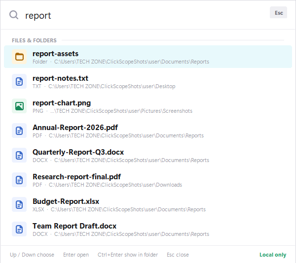
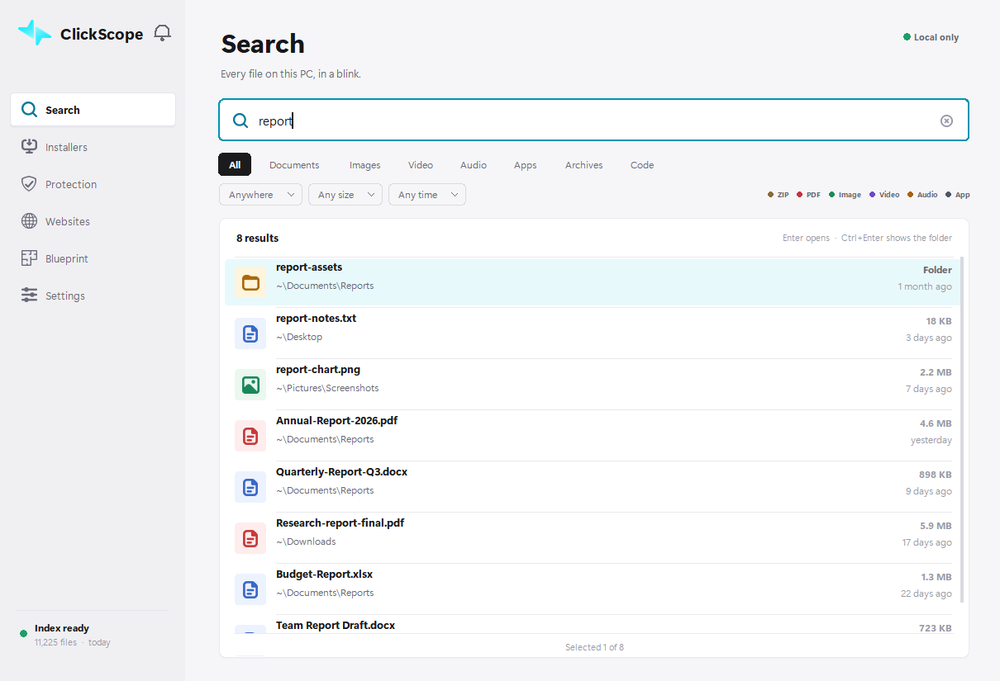
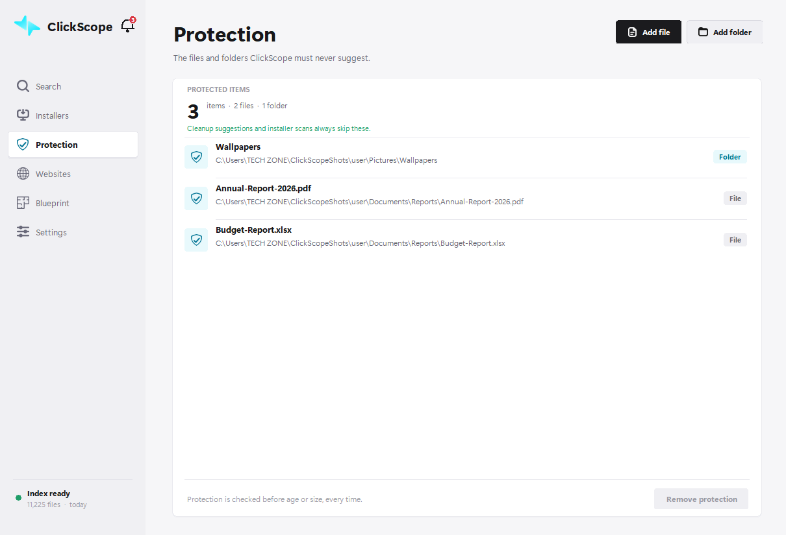
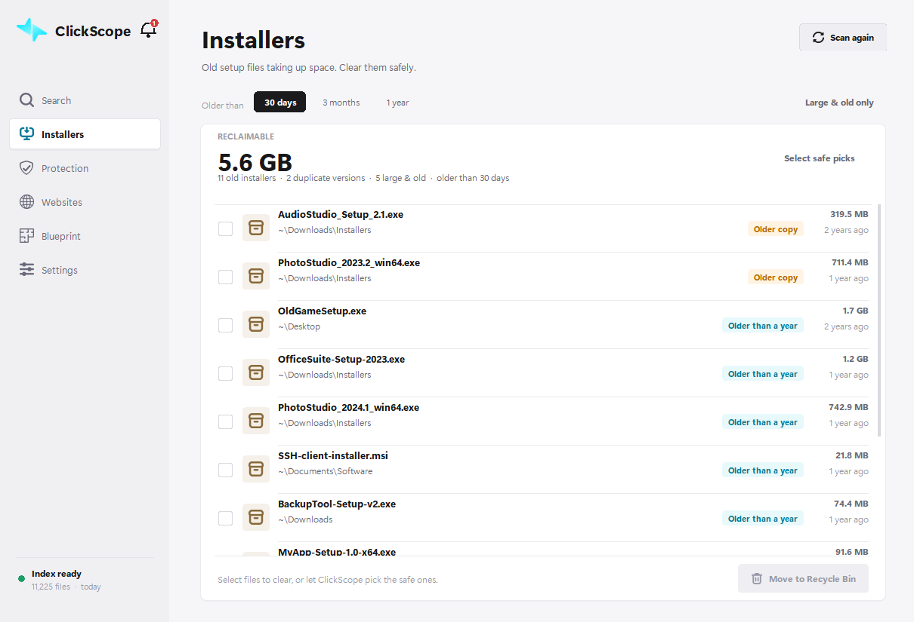
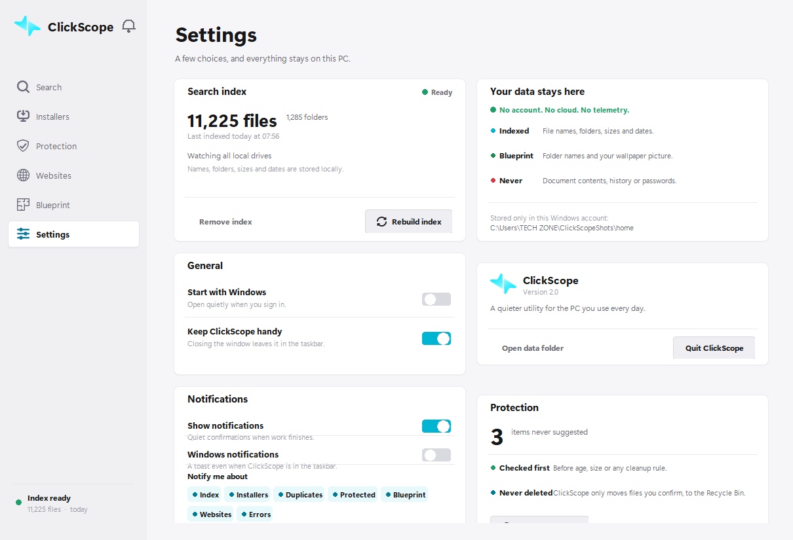
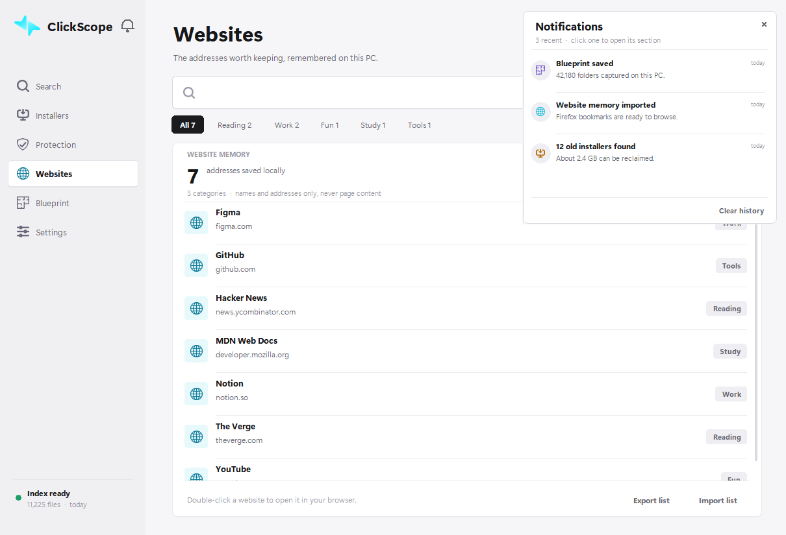

# ClickScope

Seven quiet jobs for a Windows PC, in one small local app:

- **Search** — an instant, local index of every file name on your PC, kept fresh in the background.
- **Universal Search** — one shortcut opens a floating bar anywhere in Windows for files, folders and apps.
- **Installers** — find old `.exe` and `.msi` setup files, then clear the safe ones to the Recycle Bin.
- **Protection** — mark files and folders that cleanup must never suggest or touch.
- **Websites** — remember the addresses worth keeping, search them, and import Firefox bookmarks.
- **Blueprint** — remember every folder and the current wallpaper, so a new PC can feel like home.
- **Settings** — index, startup, notifications, storage and backup, all on this PC.

No account. No cloud. No click tracking. No graphs. ClickScope only stores file names, folders,
sizes and dates, plus the wallpaper picture and website addresses you choose to keep.


Search results use quiet colour marks for ZIP, PDF, image, video and audio files, and the filter row
narrows a search by location, size and date. `Enter` opens a result; `Ctrl+Enter` shows it in Explorer.

**Universal Search** stays out of the way until you press `Ctrl+Alt+Space` (changeable in Settings).
A small bar appears over the current app and searches the same local index plus your Start Menu apps.
`Up`/`Down` chooses, `Enter` opens, `Ctrl+Enter` shows the item in Explorer, and `Esc` closes it.



| Search filters | Protection |
| --- | --- |
|  |  |

| Installers | Websites |
| --- | --- |
|  |  |

| Blueprint | Settings |
| --- | --- |
|  |  |

The bell opens the notification history. Clicking a notification jumps to the section it came from;
opening ClickScope from a Windows toast does the same. Notifications never delete, move or change a file.



## Get the app

### Option A: build on your PC
1. Install Python 3.10+ from [python.org](https://www.python.org/downloads/) and tick **Add Python to PATH**.
2. Double-click `build.bat`. The portable app appears in `dist\ClickScope.exe`.
3. For the installer too, install [Inno Setup 6](https://jrsoftware.org/isdl.php) first; it appears in
   `installer_output\ClickScope-Setup.exe`.

### Option B: let GitHub build it
1. Put this folder in a GitHub repository (private is fine).
2. Open **Actions → Build ClickScope → Run workflow**.
3. Download **ClickScope-Portable** or **ClickScope-Setup** when the run finishes.

## First run

1. **Search** starts on an intro card. Press **Index this PC**. One pass over your drives builds the
   local index; after that, new and downloaded files are picked up automatically. Disconnect an
   external drive and its rows are set aside; reconnect it and ClickScope picks it up again.
2. Type any part of a file name. Results open with `Enter`; `Ctrl+Enter` shows the file in Explorer.
   The second filter row limits results by folder, size and date.
3. Press `Ctrl+Alt+Space` anywhere in Windows to open **Universal Search**. Type part of a file,
   folder or Start Menu app name; `Enter` opens it and `Ctrl+Enter` shows it in Explorer. Change the
   shortcut, or turn the feature off, in **Settings → Universal search**.
4. **Protection** comes before every cleanup rule. Add a file or folder here and it will never be
   suggested for removal or included in a safe-pick selection.
5. **Installers** scans the index for setup files older than 30 days. Tick files yourself, or use
   **Select safe picks** (older duplicate versions and files over a year old). Nothing is removed
   until you confirm, and files always go to the Recycle Bin. Older duplicates are matched by name
   and version, and files over a year old that are also large are marked separately.
6. **Websites** keeps a name, address and category for each site. Search by any of them, add sites
   yourself, or **Import Firefox** to read bookmark titles and addresses from a temporary copy of
   `places.sqlite`. Export the list to JSON and import it on another PC. Duplicate addresses are
   merged, and page content is never read.
7. **Blueprint** saves your folder tree and wallpaper as a snapshot. **New snapshot** captures the
   current PC; **Restore folders** recreates only missing folders; **Use saved** puts the wallpaper
   back. **Export** writes one `.clickdna` file; **Import** on another PC brings it back. Invalid
   files are rejected before anything is written, and existing folders are never overwritten.
8. **Settings** rebuilds or removes the index, starts ClickScope with Windows, controls which
   notification types appear, shows how much data is stored, and can move that data to a custom
   folder. **Back up data** writes one verified ZIP with settings, protection, websites,
   notifications and blueprints — not the rebuildable search index.

## Try it without touching your data

Double-click `ClickScope-Demo.bat`, or run:

```bat
python src\main.py --demo
```

Demo mode uses a separate throw-away folder in your temp directory. Your real index and blueprints
are not opened.

## Where things are stored

Everything lives in `%APPDATA%\ClickScope\` unless you choose another folder in Settings:

| Path | Contents |
|------|----------|
| `index.db` | File names, folders, sizes, dates and file kinds |
| `protection.json` | Protected file and folder names and fingerprints |
| `websites.json` | Website names, addresses and categories |
| `notifications.json` | Notification settings and recent history |
| `blueprints\` | Folder lists and saved wallpaper copies |
| `wallpapers\` | Cached wallpaper previews |
| `state.json` | Small settings such as installer age, startup, shortcut and search scope |
| `location.txt` | Pointer to the custom data folder, when one is chosen |

Set `CLICKSCOPE_HOME` to use a different folder (portable use or tests):

```bat
set CLICKSCOPE_HOME=C:\ClickScopeData
python src\main.py
```

Changing the storage location copies data and leaves the old folder untouched. The search index is
rebuilt at the new location because it is derived from your files.

## Privacy

ClickScope makes no network requests. It never reads file contents, keystrokes, screenshots, browser
history, cookies or passwords. The Firefox import reads only bookmark titles and URLs, from a
temporary read-only copy of the bookmark database. The global shortcut uses Windows
`RegisterHotKey` for one combination only — there is no keyboard hook and no key logging. See
[TRUST.md](TRUST.md) for the checkable version.

## Development

```bat
python src\main.py            REM run from source
python src\main.py --smoke    REM open and close after ~2 seconds
python tests\test_filesearch.py
python tests\test_installers.py
python tests\test_blueprint.py
python tests\test_protection.py
python tests\test_websites.py
python tests\test_notifications.py
python tests\test_appdata.py
python tests\test_hotkey.py
python tests\test_apps.py
python tests\test_no_network.py
python tests\ui_probe.py      REM builds every page off-screen
```

The UI is Tkinter with a small custom canvas component library (`src/uikit.py`), a warm light theme
(`src/theme.py`) and springs from `src/motion.py`. Pages live in `src/pages.py` and `src/ui.py`; their
engines are `src/filesearch.py`, `src/installers.py`, `src/protection.py`, `src/websites.py`,
`src/notifications.py`, `src/blueprint.py` and `src/appdata.py`. Universal Search lives in
`src/quickbar.py`, with the global shortcut in `src/hotkey.py` and the local Start Menu list in
`src/apps.py`. Icons are a bundled pack in
`assets/icons/` (bold 24px line icons), tinted and cached at draw time by `src/uikit.py`; without
Pillow the app falls back to the drawn glyphs, so the build scripts install Pillow with PyInstaller.
Old click-tracking modules may remain in the folder for reference but are not imported by the app.

MIT licensed. See [LICENSE](LICENSE).

The feature-by-feature audit and remaining manual checks are in
[docs/FEATURE-REPORT.md](docs/FEATURE-REPORT.md).
