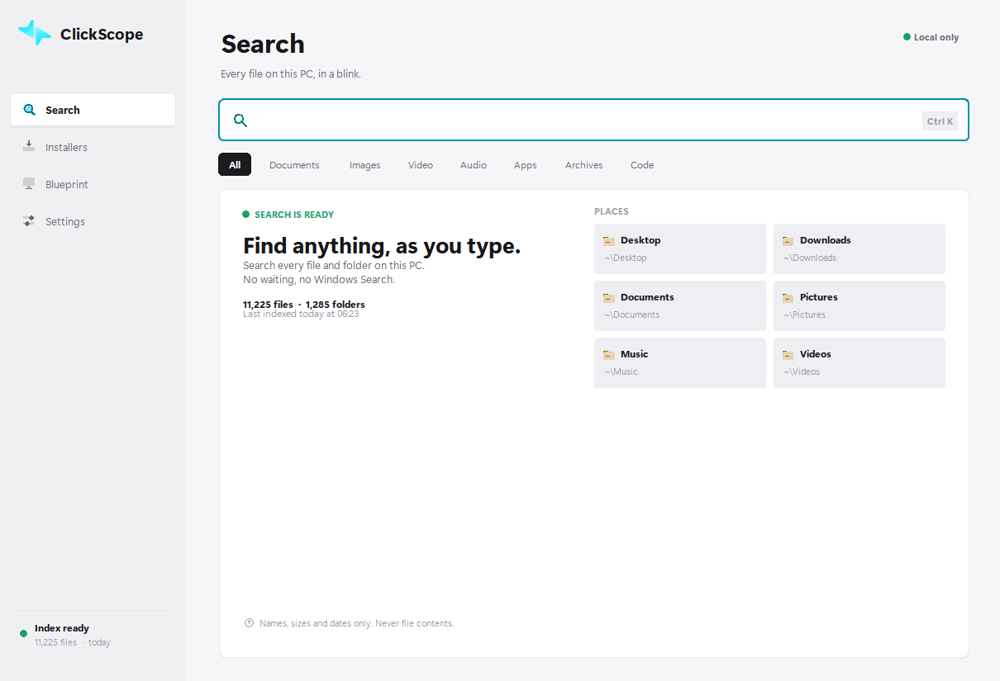
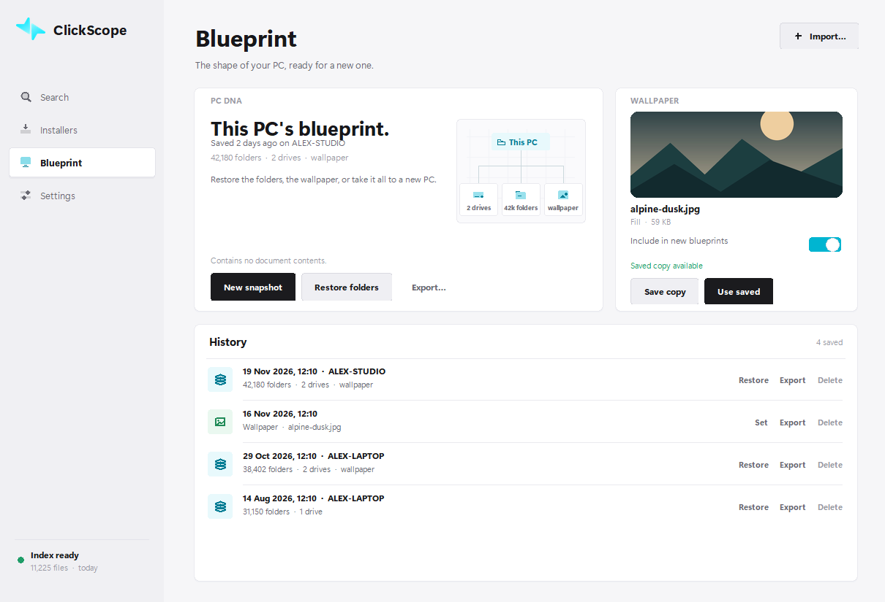

# ClickScope

Four quiet jobs for a Windows PC, in one small local app:

- **Search** — an instant, local index of every file name on your PC, kept fresh in the background.
- **Installers** — find old `.exe` and `.msi` setup files, then clear the safe ones to the Recycle Bin.
- **Blueprint** — remember every folder and the current wallpaper, so a new PC can feel like home.
- **Settings** — rebuild or remove the index, start with Windows, and see exactly what is stored.

No account. No cloud. No click tracking. No graphs. ClickScope only stores file names, folders,
sizes and dates, plus the wallpaper picture you choose to keep.



| Installers | Blueprint |
| --- | --- |
|  |  |

## Get the app

### Option A: build on your PC
1. Install Python 3.10+ from [python.org](https://www.python.org/downloads/) and tick **Add Python to PATH**.
2. Double-click `build.bat`. The portable app appears in `dist\ClickScope.exe`.
3. For the installer too, install [Inno Setup 6](https://jrsoftware.org/isinfo.php) first; it appears in
   `installer_output\ClickScope-Setup.exe`.

### Option B: let GitHub build it
1. Put this folder in a GitHub repository (private is fine).
2. Open **Actions → Build ClickScope → Run workflow**.
3. Download **ClickScope-Portable** or **ClickScope-Setup** when the run finishes.

## First run

1. **Search** starts on an intro card. Press **Index this PC**. One pass over your drives builds the
   local index; after that, new and downloaded files are picked up automatically.
2. Type any part of a file name. Results open with `Enter`; `Ctrl+Enter` shows the file in Explorer.
3. **Installers** scans the index for setup files older than 30 days. Tick files yourself, or use
   **Select safe picks** (older duplicate versions and files over a year old). Nothing is removed
   until you confirm, and files always go to the Recycle Bin.
4. **Blueprint** saves your folder tree and wallpaper as a snapshot. **New snapshot** captures the
   current PC; **Restore folders** recreates only missing folders; **Use saved** puts the wallpaper back.
5. **Export** writes one `.clickdna` file (folder list, wallpaper and a short README). **Import** on
   another PC brings it back. Document contents are never included.

## Try it without touching your data

Double-click `ClickScope-Demo.bat`, or run:

```bat
python src\main.py --demo
```

Demo mode uses a separate throw-away folder in your temp directory. Your real index and blueprints
are not opened.

## Where things are stored

Everything lives in `%APPDATA%\ClickScope\`:

| Path | Contents |
|------|----------|
| `index.db` | File names, folders, sizes, dates and file kinds |
| `blueprints\` | Folder lists and saved wallpaper copies |
| `wallpapers\` | Cached wallpaper previews |
| `state.json` | Small settings such as the installer age filter |

Set `CLICKSCOPE_HOME` to use a different folder (portable use or tests):

```bat
set CLICKSCOPE_HOME=C:\ClickScopeData
python src\main.py
```

## Privacy

ClickScope makes no network requests. It never reads file contents, keystrokes, screenshots,
browser history or passwords. See [TRUST.md](TRUST.md) for the checkable version.

## Development

```bat
python src\main.py            REM run from source
python src\main.py --smoke    REM open and close after ~2 seconds
python tests\test_filesearch.py
python tests\test_installers.py
python tests\test_blueprint.py
python tests\test_no_network.py
```

The UI is Tkinter with a small custom canvas component library (`src/uikit.py`), a warm light theme
(`src/theme.py`) and springs from `src/motion.py`. The four features live in `src/pages.py` and
`src/ui.py`; their engines are `src/filesearch.py`, `src/installers.py` and `src/blueprint.py`.
Icons are drawn in code, not loaded from an icon font or image files: navigation uses two-tone
icons (a light body plus one accent detail) following the [Kubai Icons](https://github.com/kubai087/kubai-icons)
duotone guide, and everything else uses the same 16-unit grid as thin line glyphs.
Old click-tracking modules may remain in the folder for reference but are not imported by the app.

MIT licensed. See [LICENSE](LICENSE).
